# TicketPilot AI

An AI-assisted customer support desk for a made-up software company called **Orbitly**.

A customer raises a ticket. An AI agent reads it, finds help articles, and writes a draft reply. **A person checks the draft before anything is sent.** Risky requests, like refunds, are never answered by the AI. They go straight to a person.

> This is a learning and portfolio project. All data is dummy data.

**Status:** works on my computer. Not deployed yet.

[Live demo](https://ticket-pilot-ai-app.vercel.app) | [Source code](https://github.com/asim-momin-7864/ticket-pilot-ai-app)

---

## Screenshots

**Home page**

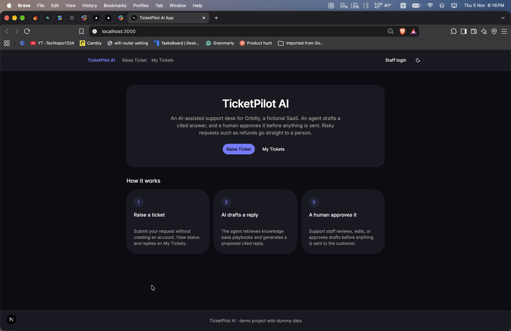

**Raise Ticket page**

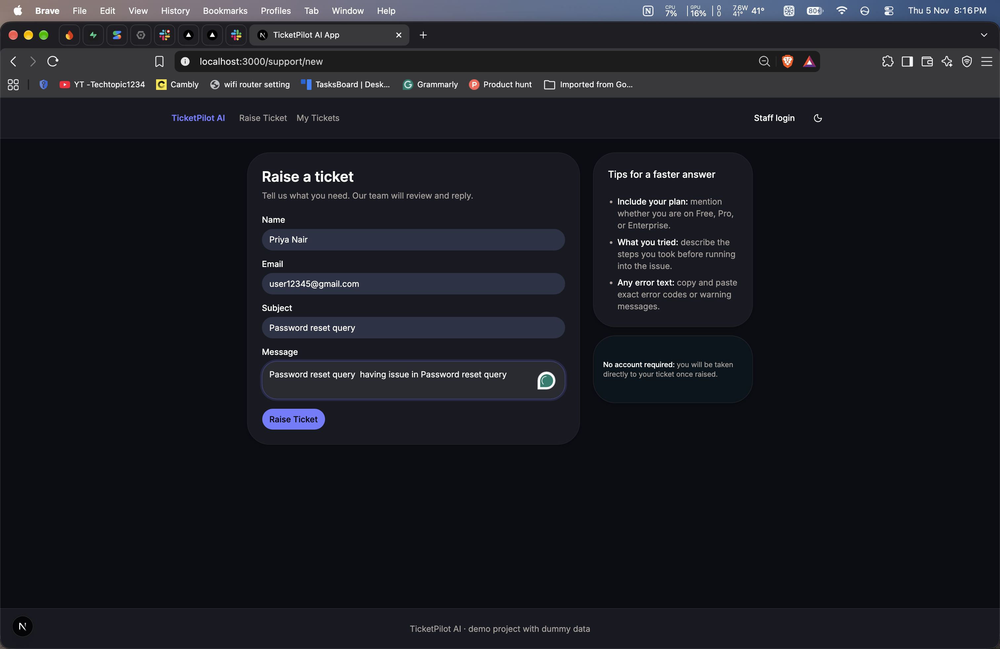

**Ticket status page (customer view)**

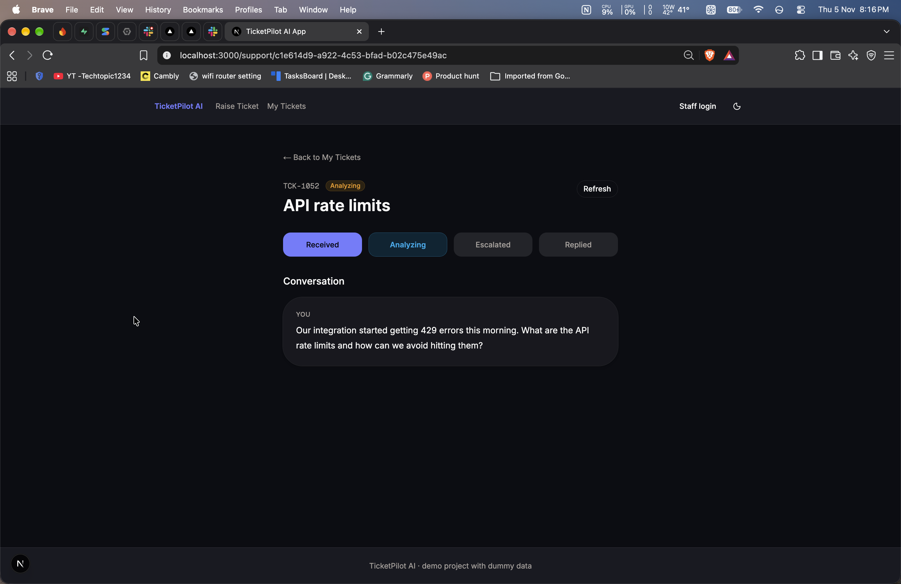

**My Tickets page**

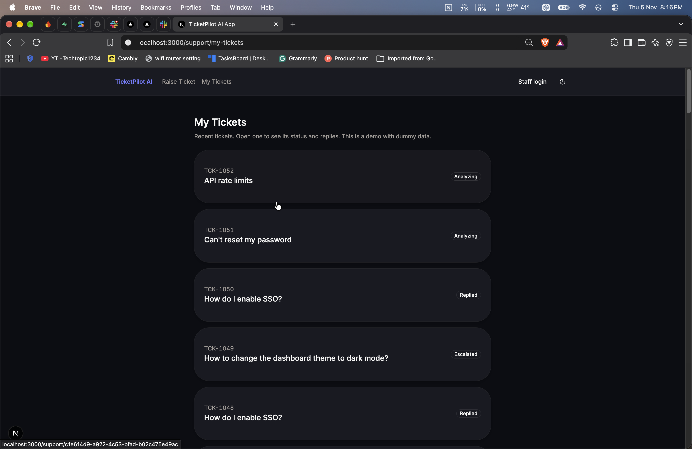

**Staff login page**

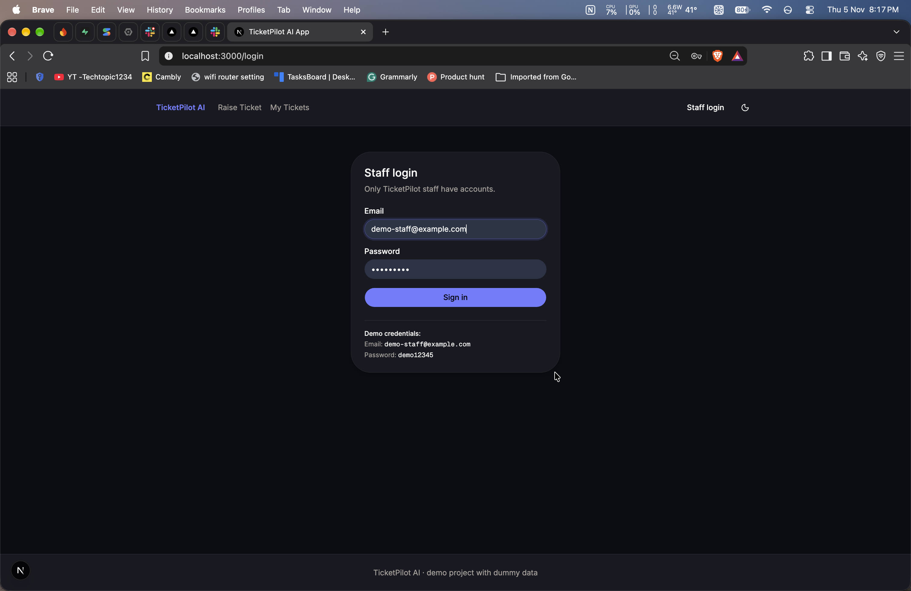

**Admin inbox**

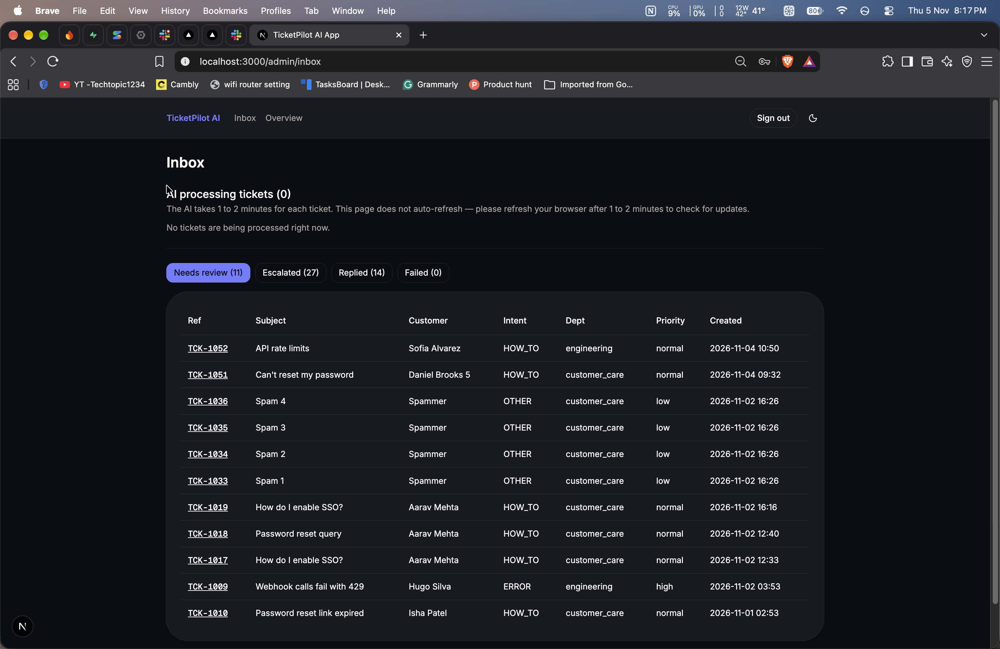

**Admin ticket page with the AI draft and sources**

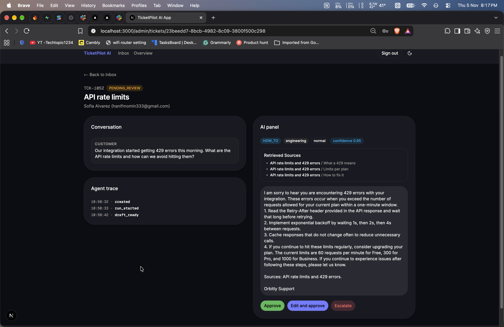

**Admin overview dashboard**

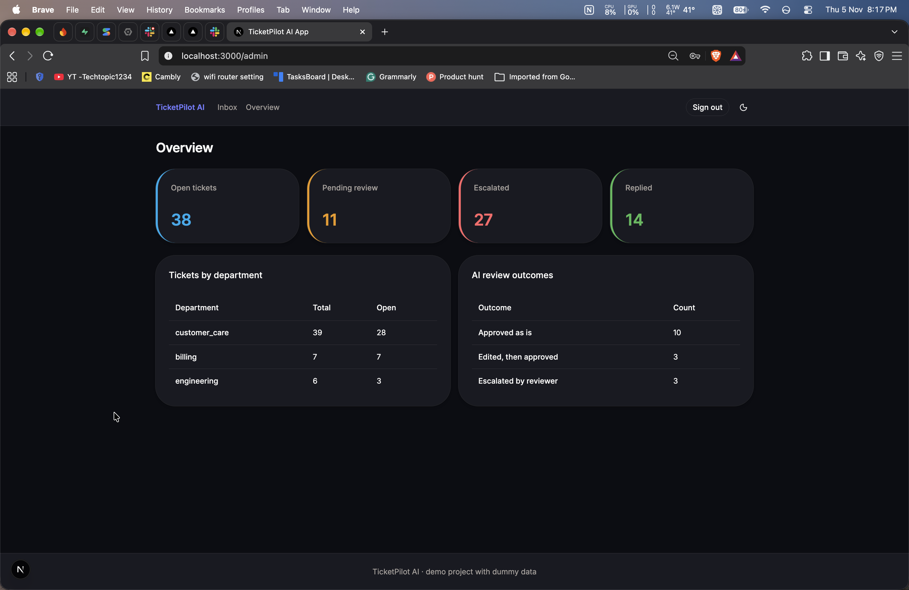

**n8n workflow (send email)**

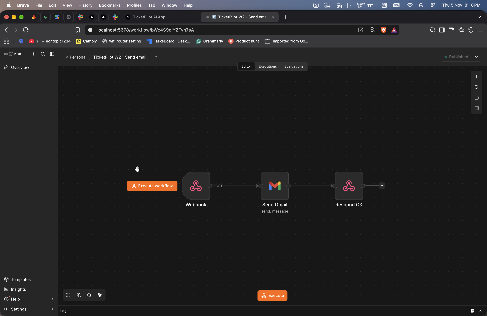

**Slack message for an escalated ticket**

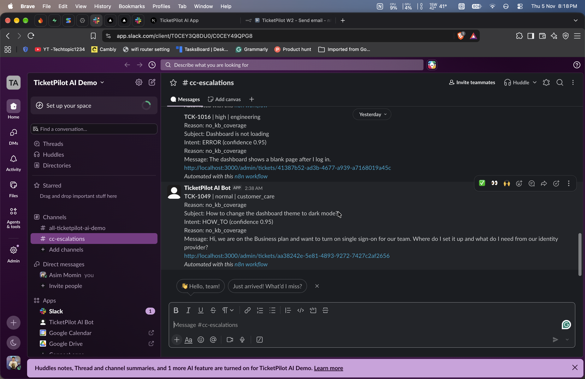

---

## What does this project do?

1. A customer fills in a short form to **raise a ticket**. No account is needed.
2. The customer gets a private link to see the ticket status.
3. An **AI agent** cleans the message, works out what it is about, and checks the safety rules.
4. If the ticket is safe, the agent searches the **knowledge base** (help articles) and writes a draft reply with sources.
5. If the ticket is risky (refund, cancellation, legal, security, personal data), the agent does **not** answer. The ticket is marked **Escalated** and the team is told in Slack.
6. A staff member opens the ticket in the admin area and can **Approve**, **Edit and approve**, or **Escalate**.
7. After approval, the reply is sent to the customer by email through **n8n**.

**The golden rule:** the AI only suggests. A person decides.

---

## Features

**Customer side (no login)**

- Raise a ticket with name, email, subject and message
- Ticket status page with 3 simple steps: Analyzing, Escalated, Replied
- See the replies from support on the status page
- My Tickets page with recent tickets (demo only, see "Known limits")

**Staff side (login needed)**

- Inbox with tabs: Needs review, Escalated, Replied, Failed
- Ticket page with the conversation, the AI draft, the sources it used, and a simple event log
- Approve, Edit and approve, or Escalate a draft
- Re-run button for tickets where the AI step failed
- Overview page with counts, tickets by department, and how staff reviewed the AI drafts

**Safety**

- A person approves every reply before it is sent
- Rules written in code (not in a prompt) decide which tickets must go to a person
- Staff pages are protected in three places: the page, the server action, and the database
- Spam protection: a hidden form field and a limit of 5 tickets per hour for each email

---

## How a ticket moves

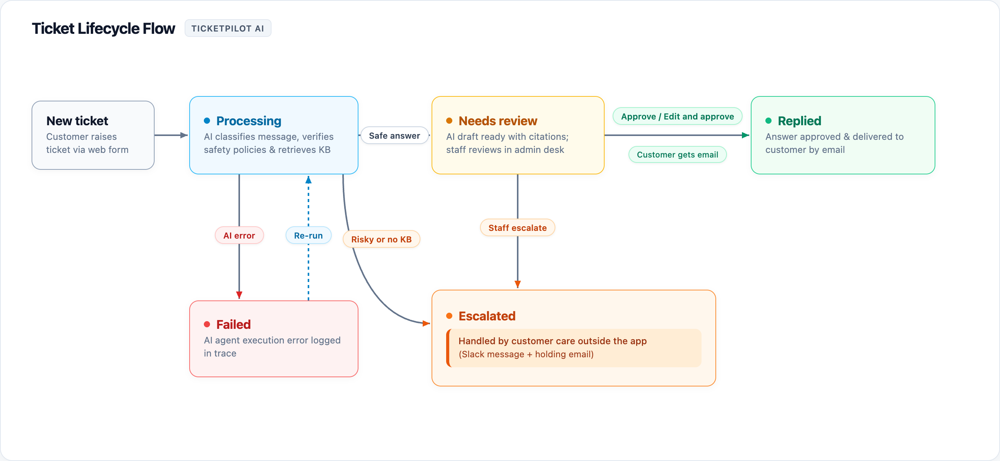

<!-- file: docs/screenshots/ticket-flow.png (a diagram of the flow below; delete this image line if you do not have one) -->

```
Customer raises a ticket
        |
        v
Ticket saved in Supabase  --->  Customer gets a private status link
        |
        v
AI agent starts
   1. Clean the message
   2. Understand it (what it is about, which department, how urgent)
   3. Safety rules: is it risky?
        |
        +-- Risky  --->  Status ESCALATED  --->  Slack message to the team (n8n)
        |
        +-- Safe   --->  4. Search the knowledge base
                         5. Write a draft reply with sources
                         6. Save the draft, status PENDING_REVIEW
                                   |
                                   v
                         Staff reviews the draft
                           - Approve
                           - Edit and approve
                           - Escalate
                                   |
                                   v
                         Reply saved + email sent (n8n)
                         Status REPLIED
```

If no help article matches, the ticket is escalated too. If the AI step crashes, the ticket is **Failed**, and staff press **Re-run**.

### Ticket statuses

| Status         | Meaning                                       |
| -------------- | --------------------------------------------- |
| PROCESSING     | The AI agent is working on it                 |
| PENDING_REVIEW | A draft is ready and waits for a staff member |
| ESCALATED      | A person must handle it                       |
| REPLIED        | A reply was sent                              |
| RESOLVED       | The ticket is finished                        |
| FAILED         | Something went wrong; staff can press Re-run  |

Customers see friendlier names: Analyzing, Escalated, Replied.

### Who does what

- **Next.js** shows the pages and runs the server actions.
- **The agent code** (LangGraph) decides what to do with a ticket.
- **Supabase** stores tickets, messages, events and the knowledge base.
- **n8n** only delivers messages (email and Slack). It never makes decisions.

---

## Tech stack

| Part                    | Tool                                                    |
| ----------------------- | ------------------------------------------------------- |
| Framework               | Next.js (App Router), React 19, TypeScript              |
| Styling                 | Tailwind CSS v4, shadcn/ui                              |
| Database and login      | Supabase (Postgres, Auth, Row Level Security, pgvector) |
| AI agent                | LangGraph.js                                            |
| AI model                | Google Gemini                                           |
| Checking data           | Zod                                                     |
| Sending email and Slack | n8n                                                     |

---

## Database

The database has 5 tables, 2 dashboard views and 1 search function. The full SQL is in `docs/ticketpilot_schema.sql`.

| Name                | What it is for                                                          |
| ------------------- | ----------------------------------------------------------------------- |
| `profiles`          | Staff users only (role ADMIN or AGENT). Customers have no row.          |
| `tickets`           | One row per ticket, with status, department, priority and the link code |
| `ticket_messages`   | Customer messages, AI drafts and staff replies                          |
| `ticket_events`     | A log of everything that happened (also shown as the event log)         |
| `kb_chunks`         | Help articles cut into small pieces, each with an AI embedding          |
| `match_kb_chunks`   | Function that finds the pieces closest in meaning to a question         |
| `dashboard_*` views | Counts for the admin overview page                                      |

---

## Project structure

<!-- Check this list after the clean-up. Delete any line for a folder or file that no longer exists. -->

```
src/
  actions/          Server actions (create ticket, review ticket, login, sign out)
  app/              Pages
    page.tsx          Home page
    support/          Customer pages (new ticket, my tickets, ticket status)
    login/            Staff login
    admin/            Staff pages (overview, inbox, ticket page)
  components/       Forms, header and shadcn/ui components
  lib/
    agent/            The AI agent (clean, classify, rules, search, draft, graph)
    integrations/     Code that talks to n8n
    supabase/         Supabase clients
    require-staff.ts  Checks that the user is staff
docs/
  ticketpilot_schema.sql   Database tables and security rules
  seed.sql                 Demo data
  n8n/                     n8n workflows (send email, notify Slack)
scripts/
  try-agent.ts             Run the agent from the terminal
```

---

## Pages

| Page          | Address               | Who can open it      |
| ------------- | --------------------- | -------------------- |
| Home          | `/`                   | Everyone             |
| Raise Ticket  | `/support/new`        | Everyone             |
| My Tickets    | `/support/my-tickets` | Everyone             |
| Ticket status | `/support/<code>`     | Anyone with the link |
| Staff login   | `/login`              | Everyone             |
| Inbox         | `/admin/inbox`        | Staff only           |
| Ticket page   | `/admin/tickets/<id>` | Staff only           |
| Overview      | `/admin`              | Staff only           |

---

## Run it on your computer

### What you need

- Node.js (a recent version) and npm
- A free [Supabase](https://supabase.com) project
- A Google Gemini API key from Google AI Studio
- (Optional) An [n8n](https://n8n.io) instance, a Gmail account and a Slack workspace for real emails and Slack messages

### Steps

**1. Get the code and install**

```bash
git clone <your-repo-url>
cd ticket-pilot-ai-app
npm install
```

**2. Set up the database**

In the Supabase dashboard, open the **SQL Editor** and run these files in this order. Use a new, empty project.

1. `docs/ticketpilot_schema.sql`
2. `docs/seed.sql`

**3. Create your staff account**

This app has no sign-up page on purpose. Staff accounts are made by hand:

1. In Supabase, go to **Authentication > Users > Add user**. Enter an email and a password.
2. Copy the new user's ID.
3. In the SQL Editor, run this with your ID:

```sql
insert into public.profiles (id, full_name, role)
values ('<paste-user-id-here>', 'Demo Staff', 'ADMIN');
```

4. In Supabase, turn off public sign-ups (Authentication settings) so nobody else can create an account.

**4. Add your environment variables**

Copy `.env.example` to `.env.local` and fill in the values. You will need these:

<!-- Check these names against your real .env.example and src/. Search the project for process.env. Change any name that is different. -->

| Variable                    | What it is                                            |
| --------------------------- | ----------------------------------------------------- |
| `SUPABASE_URL`              | Your Supabase project address                         |
| `SUPABASE_ANON_KEY`         | Supabase public key                                   |
| `SUPABASE_SERVICE_ROLE_KEY` | Server-only key. Never share it.                      |
| `GEMINI_API_KEY`            | Google Gemini key                                     |
| `EMBEDDING_DIM`             | Size of the embedding. Must match the database (768). |
| `N8N_BASE_URL`              | Address of your n8n (optional)                        |
| `N8N_SHARED_SECRET`         | Secret shared with n8n (optional)                     |
| `APP_BASE_URL`              | `http://localhost:3000` on your computer              |
| `DEMO_MODE`                 | `true` shows an email preview instead of sending      |

> Never commit `.env.local`. The service role key must stay on the server. Never put it in code that runs in the browser.

**5. (Optional) Set up n8n**

1. Import the two files from `docs/n8n/` into n8n: `w2-send-email.json` and `w3-notify-slack.json`.
2. Connect your Gmail and Slack accounts inside n8n.
3. Put the webhook address and the shared secret into `.env.local`.

If you skip this step, the app still works. Tickets, drafts and reviews work fine. Only the email and Slack messages are missing.

**6. Start the app**

```bash
npm run dev
```

Open [http://localhost:3000](http://localhost:3000).

---

## Try it yourself

1. Open **Raise Ticket** and send: `How do I enable SSO?` Wait a little. The AI writes a draft.
2. Send a second ticket: `I was charged by mistake and I want a refund.` This one should be **Escalated** with no AI answer.
3. Go to **Staff login** and sign in.
4. Open the **Inbox**. The SSO ticket is under **Needs review**. The refund ticket is under **Escalated**.
5. Open the SSO ticket. Read the draft and the sources. Press **Approve**.
6. Open the ticket status page and see the reply.

### Demo login for visitors

| Role  | Email                  | Password  |
| ----- | ---------------------- | --------- |
| Staff | demo-staff@example.com | demo12345 |

This is a demo account with dummy data. In demo mode, no real email is sent.

---

## How it stays safe

- **A person approves every AI reply.** The agent saves a draft. Only the review action can send it.
- **Safety rules are code.** The list of risky topics is in `src/lib/agent/policy.ts`. A prompt cannot talk the code out of it.
- **Customer text is treated as data**, not as instructions.
- **No accounts for customers.** Each ticket gets a long random link.
- **Staff checks in every action.** Each staff server action calls `requireStaff()` first. Hiding a page is not enough.
- **Database rules (RLS).** Only staff can read tickets. The app writes to the database from the server with the service key, so there are no write rules for normal users.
- **Knowledge base search is server only.** Normal users cannot call the search function. It returns only public, current articles, so internal notes never reach customers.
- **Double-click safe.** The review action marks the ticket first, so two clicks cannot send two replies.
- **Spam control.** A hidden form field catches bots, and each email can raise 5 tickets per hour.
- **No secrets in the repo.** Keys live in `.env.local`.

---

## What I did not build, and known limits

I want to be honest about what this project does not do:

- **My Tickets shows recent tickets for everyone.** It shows only the reference, subject and status. I did this to keep the demo simple. In a real product, tickets would be linked to a signed-in user or a private link.
- **The private link code is a random ID stored as it is.** It is not hashed. A real product would store only a hash.
- **One admin, made by hand.** There is no sign-up page and no team page.
- **No inbound email.** Tickets come from the web form only.
- **No customer follow-ups.** A customer cannot reply on a ticket after it is answered.
- **No charts over time.** The overview shows simple counts only.
- **No automated tests yet.**
- **All data is dummy data.** Do not enter real personal information.
- **The free Gemini plan has limits.** If the AI is busy, a ticket can end as FAILED. Staff can press Re-run.

---

## What I learned

- How to build a multi-step AI agent with branches (answer or escalate)
- Why safety rules belong in code and not in a prompt
- How to keep a human in the loop before an AI reply is sent
- How Row Level Security, server actions and staff checks work together
- How to use n8n only for sending messages, and keep decisions in my own code
- How to turn help articles into embeddings and search them by meaning

---

## Author

Built by **Asim Momin** as a portfolio project.
